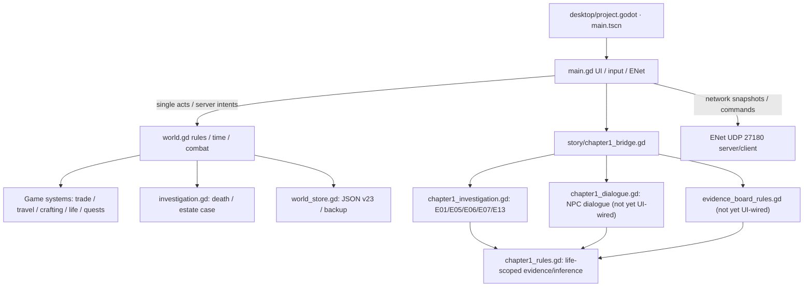
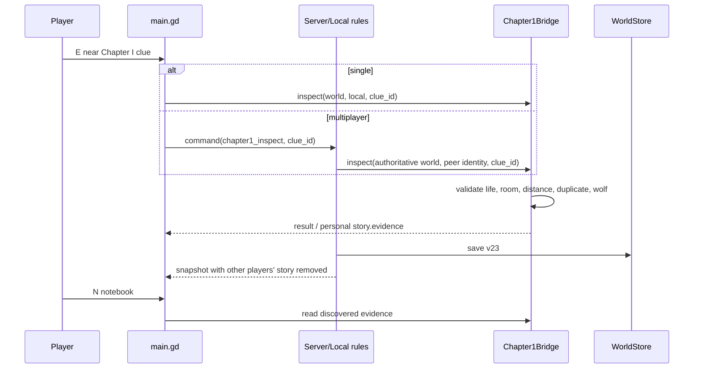

# VESTIGE — 현재 아키텍처 (코드 사실과 목표 구분)

> 기준: `feature/chapter1-input-integration` (2026-11-22) 및 독립 기술 감사 `codex/technical-baseline-audit`의 G 0.5.19·S 조사 계열 분석. 문서 이후 코드가 변경되면 재확인해야 한다. 이것은 **통합이 완전히 작동한다는 보증이 아니다.**

## 시스템 구성도

**현재 연결 사실:** `main.gd`에서 E키 조사와 N키 수첩, `chapter1_inspect` 서버 명령 및 타인 `story` 필터가 연결된 코드가 있다. NPC 대화 UI/서버 세션, 증거 조합 UI 및 `reconstruct` RPC는 이 통합 브랜치에서 아직 연결되지 않았다. `chapter1_bridge.gd`의 함수가 곧 UI로 구현되었다는 뜻이 아니다.

## 디렉터리별 책임

| 경로 | 실제 역할 |
|---|---|
| `desktop/main.gd` | 시작/싱글/클라이언트/서버 모드, HUD/모달, 입력, RPC, snapshot, 저장 호출 |
| `desktop/world.gd` | 월드 `Dictionary`, 새 생애 생성, 전투/이동/시간, 행동 디스패치 |
| `desktop/world_store.gd` | 저장 버전 검증, 임시 파일·백업·복구, 이전 버전 이관 |
| `desktop/travel.gd` / `npc_life.gd` | 지역과 NPC 일정. 같은 좌표의 다른 지역을 구분 |
| `desktop/investigation.gd` / `witness.gd` / `evidence_items.gd` | 사망 사건/주택 유품·목격 기록. Chapter I 모듈과 다름 |
| `desktop/story/chapter1_*.gd` | 제1장 관찰 증거·NPC 반응·논리 증거 링크·추론 상태 |
| `desktop/story/evidence_board_*.gd` | 제한적 추론 I03/I04/I07 및 UI 정의(현재 메인 연결 별도) |
| `desktop/*_panel.gd` | 장비·제작·거래·지도·의뢰 등 UI |
| `desktop/pixel_world.gd`, `portrait.gd` | Node2D 기반 2D/도트 화면(완성 TileMap 시스템 아님) |
| `desktop/tests/`, `scripts/` | GDScript/Python/Node 테스트·렌더·빌드 도구 |
| `docs/`, `docs/handoffs/` | 설계 및 단계별 구현 증거 |
| `game.mjs`, `server.mjs`, `public/`, `test/` | 과거 Node 기반 웹 시제품. Godot 제품 경로와 분리 |

## 데이터 흐름

`N`은 클라이언트가 자신의 전송받은 기록을 표시하며, 비공개 타인의 `story`는 스냅샷에서 제거한다. 서버에게 알려지지 않은 수첩 내용을 클라이언트가 임의로 주입해도 보상·추론을 확정할 수 없도록 모든 쓰기 동작을 서버에서 검사해야 한다.

## 저장과 생애

- G 게임 계열은 저장 `version=23` 및 이전 1~22 버전 이관/복구 구조를 가진다.
- S 스토리 단독 계열의 `version=1`과 전체 월드 구조는 다르다. **저장 파일 자동 결합을 검증한 상태가 아니다.**
- 게임 개인 상태 `people[id].life`, `room`, 인벤토리·스킬·의뢰·`notebook`와 Chapter I `people[id].story`를 별도로 관리한다. 이전 생애 `story`를 새 생애에 자동 계승하지 않는다.
- 현재 통합 코드는 `story` 필드 기록을 v23 게임 저장 경로로 통과시키지만, Chapter I 형식 검증·구버전 fixture·오류 복구/마이그레이션 통합 검증이 추가로 필요하다.
- 싱글 로드 시 경과 시간 반영과 서버 시계 운영은 별개다. 엔딩 이후 싱글 지속과 멀티 해금은 장기 설계이며 현재 엔딩 조건의 실제 플레이 연결은 미구현이다.

## 네트워크와 권한

- ENet UDP 27180 시제품. 이동/명령은 서버에 전달되어 판정하며 스냅샷은 플레이어별로 가공된다.
- 기존 `Investigation.redact`로 사망 사건의 숨겨진 진실·유품·비공개 필드를 필터링하고, 통합 계열 `main.send_snapshot`에서 **다른 사람의 `story`**를 추가로 지운다.
- 현재 PC/Mac 로컬 식별 토큰은 Steam OAuth/계정 인증과 동일한 보안 수준이 아니다.
- S의 이전 ENet 검사에서는 송신 오류 `channel 0, max channels: 0`가 기록되었다. 현재 통합판의 정상/오류 여부는 **미검증**.
- NPC 대화 세션·재구성 RPC를 임의 `command`로 열면 안 되며 요청자·거리·지역·세션·재전송/중복을 서버에서 검증해야 한다.

## 환경·검증 사실

- `desktop/project.godot`: Godot 4.5 feature, GL Compatibility, 1280×800.
- 2026-11-22 Codex 기술 감사에서 Godot 4.5.1.stable로 G 규칙 761 PASS, S 헤드리스 279 PASS를 **각각 별도 브랜치**에서 확인. 합산해 현재 통합 브랜치의 검증 결과로 사용하지 않는다.
- 현재 작업 브랜치의 신규 테스트 `test_chapter1_port_contract.gd`, `test_chapter1_input_integration.gd`는 **작성되었으나 Godot 실행 기록 없음**.
- 이 기준 브랜치의 Git 트리 조회에서는 `.github/workflows/`가 확인되지 않았다. 다른 워크플로나 외부 CI 서비스 존재 여부는 **미확인**.
- 작업자 로컬 환경, 미커밋 파일, 로컬 스태시의 최신 상태는 GitHub 원격만으로 확정할 수 없다.

## 현재와 미래 설계의 차이

| 항목 | 실제 구현 근거 | 후속 설계/미구현 |
|---|---|---|
| NPC 생활 | 안개나루 2명 고정 일정 | 세계 전체 자율 NPC/기억/행동 엔진 |
| 의뢰/이벤트 | 고정 의뢰 및 반복 납품 | 검증된 월드 사건 기반 동적 퀘스트 |
| 기록 | 일기, 유품/증거 수첩, Chapter I 데이터 구조 | 개인 생애 연대기·세계 기록실·정교한 권한 |
| 스토리 | 제1장 E 증거, 카엘/세라 대화 규칙(별도 계열), N 수첩 연결 | 전체 제1장 플레이 및 캠페인 엔딩 검증 |
| 멀티 | 로컬 ENet 시제품 | 엔딩 해금·공유 허브·지역 인스턴스·Steam 인증 |
| 생성형 AI | 게임 대화용 LLM 통합 없음 | 규칙 검증과 허용 메모리 기반 생성형 대화 |

상세한 과거 별도 계열 감사: `codex/technical-baseline-audit:docs/technical-baseline/`. 현재 인계: `docs/handoffs/chapter1-safe-module-port.md` 및 `chapter1-input-integration.md`.
