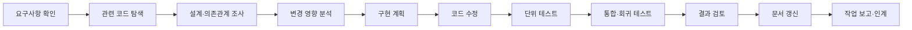

# VESTIGE — 개발 작업 표준 절차

적용 대상: ChatGPT·Codex·기타 AI/사람 개발자. 기본 책임은 ChatGPT 설계/요구사항·검토, Codex 코드 분석/구현·테스트/이력 관리지만 **승인된 일을 수행하는 누구에게나 동일한 절차가 적용된다**.

## 1. 기본 절차



**단순 문서 오탈자**는 구현 영향 분석/테스트를 간소화할 수 있다. **기존 동작을 바꾸는 변경**은 영향 분석, 검증, 결과 구분을 생략할 수 없다.

## 2. 작업 착수 점검

```sh
git fetch origin
git status --short --branch
git branch --show-current
git log -5 --oneline
git diff --stat
```

- 실제 로컬 상태를 직접 확인한다. 원격만 조회한 경우 `로컬 Git 상태 미확인`으로 적는다.
- 사용자 미커밋 변경, 스태시, 다른 worktree, QA 저장/정상 빌드를 보호한다.
- `AGENTS.md` → `ARCHITECTURE.md` → `PROJECT_STATUS.md` → 관련 기존 설계·`docs/handoffs/` 순으로 읽는다.
- 관련 파일/심볼, 호출자, 하위 모듈, 인터페이스, 저장 키, RPC, UI/모달, 테스트/CI 존재 여부를 찾는다.
- 요구사항의 수용 기준과 미확정 가정, 사용자가 승인한 작업·Git 범위를 명시한다.

## 3. 변경 영향 분석 템플릿

| 항목 | 반드시 기록할 내용 |
|---|---|
| 시작점/종점 | 어떤 입력에서 어떤 화면·저장 결과까지 전달되는가 |
| 변경 대상 | 직접 수정 파일과 API/데이터 필드 |
| 종속성 | 호출자, 읽는 모듈, 인접 시스템, 테스트 |
| 지속성 | 저장 버전, migration, backup, 재접속, death/new life |
| 권한 | 싱글/서버/클라이언트, 타인 비공개, 재전송 중복 |
| 부작용 | E/F/N, 시설/집, 전투/제작/지역 변경, 입력 모달 |
| 롤백 | 독립 브랜치/커밋, 이전 저장 fixture와 기존 빌드 보존 |
| 검증 계획 | 해당 기능 + 기존 회귀 + 시각/네트워크 수동 검증 |

공용 구조(`main.gd`, `world.gd`, `world_store.gd`), API/RPC, 저장, 공용 UI를 바꿀 때 전체 전달 경로를 재확인한다. 테스트에서 실패가 나오면 원인을 고치지 않고 테스트를 제거하거나 약화하여 통과시키지 않는다.

## 4. 단계별 수행·검증

1. **분석:** 현재 커밋, 브랜치와 관련 코드/문서를 직접 열고 사실과 계획을 구별.
2. **계획:** 최소 수정 경계, 파일 목록, 새 ID/스키마 영향, 되돌릴 수 있는 단계별 커밋.
3. **구현:** 기존 behavior를 보존하면서 필요한 범위만 수정. 미확정 서사/게임 규칙을 임의 결정 금지.
4. **단위 검사:** 변경 모듈의 테스트/유효성 검증. 실패 원인을 재현.
5. **통합/회귀:** `python3 scripts/verify_rules.py`, 해당 `desktop/tests/` 헤드리스, 환경에 맞는 `scripts/verify_*_network.py`.
6. **실사용 검사:** 이동·충돌, E/F/N, NPC 대화·아이템/집·서재, 복수 플레이어, 저장/로드, 서버 재시작. 환경이 없으면 `미실행`.
7. **결과 검토:** 모든 검사의 명령·브랜치·커밋·PASS/FAIL/미실행 이유 기록. 오류가 있다면 그대로 공개.
8. **인계:** 코드와 함께 `docs/handoffs/<task>.md` 갱신, `PROJECT_STATUS.md`에 현재 상태 반영, 다음 작업 담당자가 대화 없이 복귀 가능하도록 정리.

### 예시 명령 (환경에 맞게 실행 파일 경로 확인)

```sh
python3 scripts/verify_rules.py
godot --headless --path desktop --script res://tests/test_chapter1_port_contract.gd
godot --headless --path desktop --script res://tests/test_chapter1_input_integration.gd
```

테스트 경로는 해당 브랜치에서 실제 존재하는지 확인해야 한다. ENet 실제 테스트는 사용 중인 UDP 포트와 별도 fixture/world file을 사용하고, 다른 게임 서버와 겹치지 않도록 한다.

## 5. 상태 판정

- `planned`: 아이디어/검토 과제.
- `specified`: 승인된 명세와 수용 기준이 존재.
- `implemented`: 실제 브랜치+커밋+파일/심볼 존재.
- `verified`: 해당 코드 커밋에서 관련 테스트를 **실제로 실행**하고 통과. 검증 범위를 함께 기록.
- `blocked / failed / unverified`: 작업 중단, 검사 실패 또는 실행 증거 없음. 이 값을 성공과 혼용하지 않는다.

개별 브랜치에서 과거에 PASS했다는 증거는 새 통합 브랜치의 PASS로 자동 승계되지 않는다. 설계 문서의 JSON validator 통과는 Godot 실행 검증이 아니다.

## 6. Git 및 협업 핸드오프

- 시작 시 base SHA, 현 브랜치, 다른 에이전트가 수정하는 파일, 미커밋/스태시를 점검.
- 목적별 브랜치·worktree 사용, 위험 변경은 여러 작은 커밋으로.
- 현재 작업의 **원격 푸시·PR 생성·병합** 권한은 최신 명시 지시를 따른다. 이번 문서 전용 브랜치의 원격 반영은 허용되었지만 향후 모든 Git 조작에 대한 포괄 승인은 아니다.
- 작업 후 커밋, 대상 테스트, 남은 오류·제약, 리뷰 필요 지점, 관련 문서를 한 파일에 남긴다.
- ChatGPT/Codex가 충돌하는 설계 대안을 내면 코드/테스트 근거와 선택지(장단점)를 보고해 사용자 판단을 받는다.

## 7. 작업 종료 보고 템플릿

```md
## 작업 요약
- 요구사항 ID, 수행 범위, 미수행 범위

## 변경 내역
- 파일 / 심볼 / 변경 이유

## 영향 범위
- 호출 경로, 저장·RPC·UI·회귀 위험

## 검증 결과
- 브랜치/커밋/환경
- PASS: 명령 및 항목 수
- FAIL: 오류와 재현 조건
- 미실행: 이유 및 담당자

## Git 상태
- 기준 브랜치, 작업 브랜치, 커밋 SHA, 푸시 및 PR 상태
- 로컬 작업 트리/스태시 확인 여부

## 다음 작업
- 차단 요인, 후속 순서, 사용자 결정 필요 사항
```

이 문서만 채우는 것보다 **다음 작업자가 현재 상태를 재현할 수 있도록** 실제 커밋·테스트·인계 파일을 연결하는 것이 중요하다.
