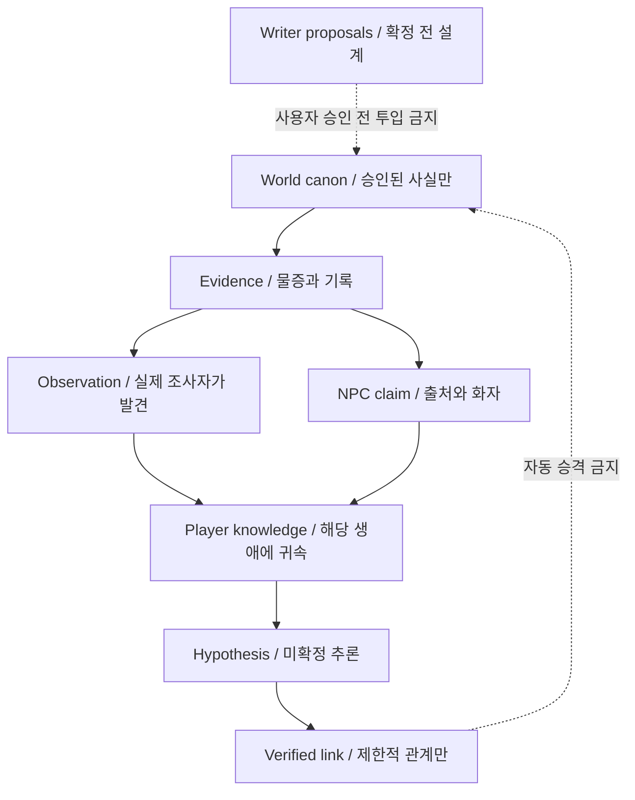

# VESTIGE — 제1장 Character Knowledge Tree v0.1 (설계용)

> **범위:** 서사 원본·인물의 인식·플레이어 관찰을 데이터로 분리하기 위한 모델 제안. 구현·API·저장 마이그레이션 요청 아님. `CHAPTER1_CHARACTER_BIBLE_DRAFT.md`와 함께 읽는다.
> **자료 근거:** `qa/chapter1-p1i-macos-input`의 `chapter1_dialogue.gd`, `chapter1_investigation.gd`, `chapter1_rules.gd`; 역사 문서는 `feature/chapter1-evidence-board:docs/CHAPTER1_*.md`. 이 문서의 `proposal` 값은 실제 세계의 확정 사실이 아니다.

## 1. 지식은 곧 진실이 아니다



**필드 의미**
- `status: canon_observation` — 직접 관찰된 사실과 **해당 증거가 기록되었다는 사실**.
- `status: canon_claim` — 인물이 그 말을 했다는 사실. 말한 내용의 참거짓을 보증하지 않는다.
- `status: supported_inference` — 정확히 지정된 증거가 함께 존재함으로 확인되는 제한적 연결.
- `status: proposal` — 미래 인물 성격·배경·반응 후보. **실게임 AI의 사실 조회에서 제외**.
- `status: unresolved` — 사건의 숨겨진 진실/원인, 사용자 결정 대기. **일반 NPC 및 플레이어 AI에 제공 금지**.

### 최소 지식 원자 제안

```yaml
knowledge_atom:
  id: KB-CH1-000
  subject_id: npc.iren
  predicate: "scheduled_meeting_at"
  object_id: place.forgotten_chapel
  status: canon_observation
  epistemic_scope: "diary_contains_statement"  # 약속이 적혔음, 만났음 아님
  source_id: evidence.E01
  source_type: diary
  source_speaker: null
  certainty: "documented_text"
  player_discovery: "requires_recorded_E01"
  visible_to: "discovering_player_life"
  created_at_world_time: null  # 실제 게임은 인물별 발견 시간 저장
  dialogue_tag: "iren.last_promise"
  provenance: "chapter1_investigation.gd/last_promise"
  canon_approval: "existing_code"
```

향후 도메인 저장시 NPC 공개 지식과 플레이어의 소유 증거를 혼합하지 않는다. `created_at_world_time`을 임의 날짜로 채우지 않는다. `source_id`의 의미/원본 ID는 실제 G 저장 `story.evidence`의 원본 키와의 매핑을 보존.

## 2. 엔티티 트리 — 사람/장소/증거/추론

```text
world.vestige
└── region.ash_village / 잿불 마을
    ├── npc.iren / 약초사, 현재 직접 만남 불가
    │   ├── source evidence.E01 ← original:last_promise / 이렌 일기 속 약속
    │   └── state missing_reported [실종 소문이 있음; 생사 미확정]
    ├── npc.bran / 대장장이
    │   ├── claim "이렌이 내 장갑을 고쳐 주었다"
    │   ├── claim "늑대설은 직접 목격하지 않았다"
    │   └── relationship proposal helper/caretaker
    ├── npc.sera / 서재 관리인
    │   ├── claim "이렌이 빌린 책이 미반납"
    │   ├── evidence review I03, I04, I07 (제한적 검증)
    │   └── relationship proposal archivist/guardian
    ├── npc.kael / 떠돌이
    │   ├── claim "이렌에게 도움받았다"
    │   ├── claim "표식은 내 소유" → evidence.E08 (진술)
    │   ├── claim "예배당에 간 적 있다"
    │   └── unresolved machine operator/intent
    ├── place.iren_house_entrance → evidence.E01
    └── place.forgotten_chapel
        ├── evidence.E05 (chapel_traces) / 석판 손상
        ├── evidence.E06 (kael_token) / 현장 금속 표식, 소유 확인은 발언
        ├── evidence.E07 (device_log) / 수동 가동과 이상 진동
        └── evidence.E13 (device_key) / 연결부 도구 파편
inference.I03: E05 + E07 → evidence_link_only
inference.I04: E06 + E08 → property_and_testimony_comparison
inference.I07: E07 + E13 → tool_and_record_connection
inference.I06: LOCKED (E11 불충족, 카엘의 책임은 미확정)
```

## DEC-02 승인된 관계 메타데이터

다음은 2026-11-22 사용자 결정으로 승인된 **작가용 인물 관계 정본**이며, 실제 NPC 발화·증거 획득 권한과는 별도이다.

```yaml
relationship:
  id: relationship.iren_bran
  participants: [npc.iren, npc.bran]
  type: close_friends
  status: approved_canon
  shared_values: "돌봄과 상대의 존엄을 중요하게 여김"
  value_conflict: "현재 살아 있는 이의 삶을 먼저 지킴 vs 떠난 이의 기억과 의미를 보존"
  had_disagreements: true
  conflict_event: story_event.storm_aftermath_iren_bran  # DEC-02A 승인 사건 유형; 세부 내용 미정
  conflict_aftermath: resolved_practical_damage_unresolved_emotional_wounds  # DEC-02B 승인
  friendship_continued_after_conflict: true  # DEC-02B 승인
  wound_origin: mutual_failure_to_listen  # DEC-02C 승인
  emotional_mechanism: "서로의 걱정·두려움을 충분히 듣지 못한 침묵"
  specific_words_and_actions: unknown  # 새 대사 미승인
  disclosure_to_player: after_related_record_discovered  # DEC-02D 승인
  last_meeting: unknown
  caused_disappearance: unknown
  player_knows_by_default: false
  npc_disclosure_condition: unapproved
```

`story_event.storm_aftermath_iren_bran`의 승인 범위: 마을 과거 폭풍, 집과 묘비의 피해, 그 복구에서 현재의 안전 vs 사후 기억 보존을 두고 이견. 사건의 정확한 진행/후속 관계는 `unresolved`이며 실제 플레이어 지식·증거에 자동 투입하지 않는다. **DEC-02B 승인:** 당장의 피해는 해결되었지만 감정의 상처는 풀리지 않았고, 두 사람의 가까운 우정은 이어졌다. **DEC-02C 승인:** 상처는 상대의 이야기를 충분히 듣지 못한 침묵에서 비롯되었다. 특정 발언·행동·복구 방식은 미정이다. **DEC-02D 승인:** 플레이어의 관련 기록 발견 이후 브란이 과거를 공개한다. **다음 사용자 결정 DEC-02E:** 해당 기록 유형.

서사 설계 근거: `CHAPTER1_CHARACTER_BIBLE_DRAFT.md`의 DEC-02, 갈등 장면 후보는 `CHAPTER1_BRAN_IRENE_SCENES_DRAFT.md`. 기존 `npc.bran.claim.glove_repair`는 말한 사실만 보존한다. 친밀 관계가 승인되었다고 해서 대장간 대화 또는 플레이어 수첩에 해당 정보를 자동 공개하지 않는다.

---

## DEC-02D 승인: 브란의 회상은 기록 발견 이후에만 공개

```yaml
dialogue_unlock_design:
  id: dialogue.bran.storm_memory
  status: approved_disclosure_rule
  requirement_type: related_record_discovered
  related_event_id: story_event.storm_aftermath_iren_bran
  qualifying_document: record.storm_gravestone_rubbing  # DEC-02E 승인된 작가용 ID, 현재 미구현
  document_type: gravestone_rubbing
  document_author_category: another_ash_village_resident  # DEC-02F 작가 정본
  document_author_identity: unresolved  # 이름·직업·생사 미정
  author_relationship_to_iren: independent_rubbing_action  # DEC-02G; 개인적 친분은 미정
  author_known_to_player: unresolved  # 플레이어가 제작자를 안다는 뜻 아님
  inscription_person: unresolved
  found_at: unresolved
  source_validation: future_server_approved_discovery_only
  proof_of_discovery: server_validated_future_record
  disclosure: "브란의 1인칭 회상 및 미처 듣지 못한 이야기"
  unavailable_before_discovery: true
  evidence_separation:
    record: contemporary_external_event
    bran_statement: subjective_memory
  does_not_prove: [iren_fate, chapel_operator, last_promise_partner]
  implementation_status: design_only
```

- 이 구조는 **제안된 지식 접근 계약**이고 실제 새 퀘스트/DB 필드/잠금 조건을 구현했다는 뜻이 아니다.
- DEC-02D가 확정한 것은 **기록 발견 이후**라는 공개 조건뿐이다. 기록 유형은 DEC-02E에서 **묘비의 낡은 탁본**으로 승인됐다. **DEC-02F 승인:** 제작자는 이렌이 아닌 다른 잿불 마을 주민이다. **DEC-02G 승인:** 제작은 이렌의 영향 없이 주민 본인의 판단이었다. 그 주민의 구체적 신원과 개인적인 친분 여부, 원본 비문, 발견 위치와 조사 방법은 이후 결정으로 보류한다. DEC-02H에서는 상실의 기억을 제작 동기로 승인했다. 다음은 DEC-02I(잃은 이의 관계)다. 브란이 그 제작자를 아는지도 아직 정본이 아니다.
- 플레이어의 기존 E01 일기 획득만으로 새 폭풍 기록을 얻은 것으로 간주하지 않는다.
- 누군가의 기록을 읽은 결과와 브란이 이야기한 결과를 각각 별도 provenance로 저장하도록 향후 Codex 설계를 검토한다. 서버 권한·생애 분리·다른 플레이어 개인 기록의 무단 열람 방지는 종전 원칙 그대로다.

---

## DEC-02G 승인 — 탁본 제작자의 독립된 판단

```yaml
record:
  id: record.storm_gravestone_rubbing
  status: approved_writer_canon
  author_category: ash_village_resident_other_than_iren
  author_identity: unresolved
  authorship_reason:
    independent_of_iren_influence: true   # DEC-02G 승인
    decided_by_author_themself: true      # DEC-02G 승인
    specific_motivation: recalled_personal_loss  # DEC-02H 정본
    lost_person_relationship: deliberately_unspecified  # DEC-02I 정본: 끝까지 관계 확정 금지
    relationship_reveal_policy: never_reveal_or_infer_as_canon
    writer_secret_relationship: none_defined
    author_encounter_policy: indirect_traces_only  # DEC-02J 승인, NPC 직접 대면 없음
    lost_person_fate: unresolved          # 사망/실종 단정 금지
    same_as_gravestone_person: unresolved # 묘비 주인 동일성 미정
    accessible_from_rubbing_alone: false # 제작 동기를 관찰 사실로 유출 금지
  relation_to_iren:
    initiated_by_iren: false
    collaborated_with_iren_on_rubbing: false
    ever_met_iren: unresolved
    personally_known_to_iren: unresolved
  author_known_to_bran: unresolved
  author_known_to_player: unresolved
  memorial_name: unresolved
  storage_location: interior_of_storm_rebuilt_house  # DEC-02K 승인; 구체적 보관 지점 미정
  implemented_as_game_evidence: false
```

`independent_of_iren_influence`는 탁본 제작의 동기와 결정에 관한 정본일 뿐, 두 사람이 서로 낯선 사이였다는 뜻이 아니다. 출처가 없는 제작자 이름이나 이렌의 소유권을 새 사실로 추정하지 않는다.

**DEC-02H 승인:** 제작 주민은 과거 누군가를 잃었던 기억이 떠올라 스스로 탁본을 만들었다. 잃은 대상·관계·사망 또는 실종 여부는 미확정. **DEC-02I 승인:** 잃은 이와의 관계는 작품 끝까지 명확히 밝히지 않으며 작가 내부 정답도 임의로 만들지 않는다. **DEC-02J 승인:** 제작 주민은 제1장에 직접 등장하지 않고 탁본·타인의 회상 등 간접 흔적으로만 존재한다. **다음 DEC-02K:** 탁본 최초 발견 장소. 현행 E01/E05/E06/E07/E08/E13 또는 플레이어 생애별 저장 구조는 변경하지 않는다.

## DEC-02J 승인 — 제작 주민 직접 출연 금지, 간접 증거만

```yaml
rubbing_author_presentation:
  chapter: 1
  encounter_policy: indirect_traces_only
  author_npc_visible: false
  author_dialogue_available: false
  author_direct_flashback_voice: false
  authored_rubbing_exists: true
  initial_discovery_location: interior_of_storm_rebuilt_house  # DEC-02K 승인
  rebuilt_house_occupancy: unoccupied_but_maintained  # DEC-02L 승인
  reason_vacant: unresolved
  maintenance_person: unresolved
  legal_entry_method: formal_investigation_commission  # DEC-02M 승인
  commission_requester: npc.sera  # DEC-02N 승인; 기록 담당자로서 정식 의뢰
  requester_is_house_owner: unresolved
  requester_is_house_manager: unresolved
  requester_can_grant_entry_directly: unresolved
  requester_knows_rubbing_before_commission: unresolved
  commission_purpose: inventory_remaining_materials_in_maintained_empty_house  # DEC-02O 승인
  rubbing_preknown_to_sera: false  # 예상치 못한 조사 발견, 작가의 공개 구성
  report_contents: required_object_inventory_and_optional_bran_recollection  # DEC-02P
  inventory_report_required: true
  inventory_report_enough_for_completion: true
  bran_memory_player_disclosure_choice: true
  bran_memory_statement_separate_from_observation: true
  bran_prior_consent_required_for_sharing: false  # DEC-02Q 승인
  sharing_at_player_discretion: true
  bran_actual_permission_given: unresolved  # 동의가 불필요한 것과 실제 동의는 별개
  bran_awareness_after_disclosure_chapter1: false  # DEC-02R 승인
  bran_awareness_after_disclosure_chapter2_plus: unresolved
  chapter1_disclosure_notice_to_bran: prohibited
  sera_private_recollection_handling: listen_privately_do_not_record  # DEC-02S 승인
  sera_writes_bran_memory_in_public_or_private_record: false
  official_inventory_contains_bran_private_memory: false
  sera_personally_heard_if_player_shared: true  # 분기 조건부, 자동 공개 아님
  sera_explains_nonrecording_reason: false  # DEC-02T 승인
  sera_shows_nonrecording_through_actions: true
  sera_asks_player_ethics_question_about_nonrecording: false
  private_recollection_persisted_in_evidence_or_inventory: false
  final_scene_focus: sera_closes_object_inventory  # DEC-02U 승인
  objective_inventory_written_in_both_branches: true
  bran_private_memory_written_in_either_branch: false
  end_scene_variation_by_disclosure: brief_nonverbal_pause_only_if_shared  # DEC-02V 승인
  base_inventory_closing_same_across_branches: true
  private_recollection_written_across_branches: false
  specific_gesture_and_pause_duration: unresolved
  rubbing_original_post_inventory_location: sera_archive_after_authorized_transfer  # DEC-02W 승인
  rubbing_first_discovery_location_unchanged: interior_of_storm_rebuilt_house
  transfer_requires_separate_legal_permission: true
  transfer_authority: village_official_records_preservation_authority  # DEC-02X 승인
  transfer_approval_channel: official_written_authorization  # DEC-02Y 승인
  written_export_permission_issuer: village_official_records_preservation_authority
  written_export_permission_check_precedes_transfer: true
  investigation_commission_not_equivalent_to_export_permission: true
  written_permission_original_custodian: village_official_records_preservation_authority  # DEC-02Z
  written_permission_copy_verifiability_required: true
  written_permission_copy_holder: npc.sera  # DEC-02Z
  rubbing_original_custodian: npc.sera
  written_permission_and_rubbing_are_distinct_originals: true
  copy_authentication_method: unresolved
  post_transfer_rubbing_access_policy: unresolved  # DEC-02AA
  written_permission_format_or_signatory: unresolved
  custody_log_notes_authorization_verification: true
  private_bran_recollection_not_written_in_permission: true
  authority_official_name_or_membership: unresolved
  authority_is_sera_personally: unresolved  # 조직/담당 주체와 세라 관계 미승인
  transfer_approval_is_ownership_change: false
  house_entry_authorization_separate_from_rubbing_export: true
  rubbing_owner_after_transfer: unresolved
  rubbing_transfer_chain_of_custody_details: unresolved
  inventory_preserves_discovery_and_new_storage_locations: true
  bran_private_memory_not_part_of_transfer_record: true
  ending_is_main_chapter_finale: false  # 소규모 조사 에피소드만
  bran_awareness_chapter1: false
  bran_reaction_to_disclosure_chapter1: none_due_to_nonawareness
  sharing_moral_judgment: not_canonized
  sera_persists_private_statement: unresolved
  npc_relationship_or_reward_delta: unresolved
  discovered_record_provenance: observed_in_rebuilt_house_not_authored_by_sera
  bran_personal_recollection_auto_shared_with_sera: false  # 보고 범위 후속 결정
  physical_item_transfer: unresolved
  entry_authorization_chain: unresolved
  item_removal_permission: unresolved
  discovery_gate: commission_accepted_and_authorized_access  # 구현 계약 설계, 미구현
  former_resident_fate: unresolved
  first_person_account_available: false  # 제1장 직접 발화 없음
  loss_motivation_in_writer_canon: true
  loss_motivation_known_to_player: unresolved
  lost_person_relationship: deliberately_unspecified
  author_current_fate: unresolved
  bran_knows_author_identity: unresolved
```

제작 주민을 만날 수 없다는 사실은 주민이 사망/실종했다는 증거가 아니다. 브란이 알고 있는 내용도 실제 발화가 승인되기 전까지 확정하지 않는다. 탁본 자체의 관찰과 브란의 기억은 provenance를 분리하고, 별도 자료를 통해 알게 되지 않은 저자·상실 동기를 플레이어 수첩에 자동 공개하지 않는다.

**DEC-02K 승인:** 탁본은 폭풍 때 무너졌다가 복구된 집 내부에서 처음 발견한다. 집 주인·현재 거주자·탁본 보관자·세부 조사 지점은 미정이다. **DEC-02L 승인:** 복구된 집은 현재 비어 있지만 지속적으로 관리된다. 이전 거주자의 신원·생사나 빈집이 된 이유·관리자·출입 권한은 미정. **DEC-02M 승인:** 정식 조사 의뢰를 수락한 뒤 정당한 권한으로 빈집 내부를 조사한다. 의뢰자·목적·권한 전달·탁본 반출 허용 여부는 미정이다. **DEC-02N 승인:** 기록 담당자 세라가 정식 조사 의뢰자다. 그녀가 집 소유자·관리자·허가권자이거나 탁본을 미리 알고 있다는 뜻은 아니다. **DEC-02O 승인:** 세라는 관리되는 빈집에 남겨진 자료 목록 정리를 의뢰하며 탁본은 조사 과정에서 예상치 못하게 발견된다. 결과 보고의 범위는 아직 정하지 않았다. **DEC-02P 승인:** 물품 목록·탁본 출처는 세라에게 정식 보고하며 이것만으로 의뢰가 완료될 수 있다. 브란의 사적인 회상은 플레이어가 공유 여부를 선택하며 진술과 관찰 사실을 별도 출처로 유지한다. **DEC-02Q 승인:** 플레이어는 브란의 사전 명시적 동의 없이도 개인적 회상을 세라에게 선택적으로 전할 수 있다. 허락을 받았다는 의미는 아니며 브란의 사후 인지와 반응은 미정. **DEC-02R 승인:** 공유 분기에서도 브란은 제1장 동안 그 사실을 알지 못하며 자동 감정·호감도 반응을 생성하지 않는다. 제2장 이후 인지 여부는 미정. **DEC-02S 승인:** 공유받은 브란의 개인 회상은 세라가 개인적으로 듣기만 하며 공식·비공식 문서·보류 자료에 기록하지 않는다. 객관적 빈집 자료 목록은 정상 유지. **DEC-02T 승인:** 세라는 브란의 개인적 회상을 적지 않는 이유를 직접 말하거나 질문하지 않고 자료 목록에 확인 가능한 사실만 적는 행동으로 표현한다. **DEC-02U 승인:** 빈집 조사 에피소드의 마지막 장면은 세라가 확인된 자료 목록을 덮는 행동에 머문다. 브란 개인사는 공유해도 기록되지 않는다. **DEC-02V 승인:** 공유 분기에서만 세라가 자료 목록을 덮기 전 짧은 침묵 또는 손짓 차이를 보인다. 비공유는 기본 동작이며 두 분기 모두 물품 목록만 기록하고 같은 의뢰 완료 상태를 유지한다. **DEC-02W 승인:** 탁본 원본은 정당한 반출 허가 후 세라의 기록 보관 공간으로 옮긴다. 최초 발견 장소(복구된 빈집 내부)와 새 보관 장소 및 승인된 이동 이력을 분리하며 소유권·허가권자는 미정. **DEC-02X 승인:** 탁본 원본 반출은 마을의 공식 기록·보존 담당 주체가 승인한다. 해당 주체의 명칭·구성 및 세라와의 관계는 미정이며, 세라는 이관 후 보관 담당자로서 소유권·승인권자가 자동 확정되는 것이 아니다. **DEC-02Y 승인:** 마을 공식 기록·보존 담당 주체가 발급한 서면 반출 허가를 확인한 뒤 탁본 원본을 세라 보관 공간으로 이관한다. 최초 조사 의뢰서는 원본 반출 허가를 대체하지 않으며, 이관 이력에는 승인 확인·발견 장소·현재 보관 위치를 구별한다. 허가서 원본의 최종 보관 주체는 미정. **DEC-02Z 승인:** 공식 발급 주체는 서면 반출 허가서 원본을 보관하며 세라는 확인 가능한 사본을 보관한다. 탁본의 실물 원본은 세라 보관 공간에 남는다. 허가서 사본의 인증 방식 및 원본 열람 방법은 미정. **다음 DEC-02AA:** 플레이어의 탁본 원본 재열람 방식. 제1장 생성 NPC·대사·증거 ID는 사용자 구현 승인 이전까지 바꾸지 않는다.

## 3. 인물별 Know / Believe / Want / Withhold 설계

아래의 `want`, `withhold`, `personality`는 **제안**이다. `know`에 기록된 내용도 '인물이 그런 말을 했다'와 '서버가 사실을 입증했다'를 구분한다.

| 인물 | 현재 명시적으로 말한 내용(코드) | 확정되지 않은 인지·동기 — 제안 | AI가 해서는 안 될 말 |
|---|---|---|---|
| 이렌 | E01 일기에 해질녘 예배당 약속이 있음 | 다른 사람이 회복할 길을 남기고 싶음 | 누구와 만나 생사/희생을 결정했는지 |
| 브란 | 이렌이 장갑을 수선, 직접 목격 없는 늑대 소문; **작가 정본: 가까운 친구이자 신념 갈등 관계** | 손에 잡히는 일로 공동체를 돌봄 | 늑대가 원인임, 카엘이 범인임 |
| 세라 | 이렌의 책 미반납, 출처 분리 필요 | 기록의 완전성과 사람의 감정 사이 갈등 | 미확인 기록에서 조작자 확정 |
| 카엘 | 이렌에게 과거 도움받았음, E08로 표식 소유·예배당 방문 진술 | 자유와 부채, 언어로 책임을 지는 두려움 | 실제 장치 조작·고의·이렌 최후의 자백 |

### AI 대화 시 응답 원칙

1. **대화 역할(role)과 지식(knowledge)을 분리:** 세라가 차분하다는 것은 제안된 말투이고, 그녀가 사건 원인을 알고 있다는 뜻이 아님.
2. **권한:** 증거 획득 전에는 NPC의 사적 사건 기록/플레이어의 미발견 증거 이름을 선공개하지 않는다. 기본 소문은 원래 대화 선택지로만 공개.
3. **출처 부착:** 카엘 진술 E08을 설명할 때 “카엘에 따르면”처럼 말한다. 독립 목격으로 포장하지 않는다.
4. **시간:** 발견 시간은 플레이어별 world time. 원본 사건 발생 시간과 혼동하지 않는다.
5. **삶의 경계:** 플레이어 사망 후 새 생애의 조사 기록이 자동 계승되지 않는다. 세계에 남은 공개 책/소문은 별도 권한 계약 아래 조회.
6. **불확실성:** 자료 없는 질문에 그럴듯한 가상 사실을 창작하지 않는다. 대신 아는 사실의 범위를 말하거나 추가 조사를 권유.
7. **비공개 작가 노트:** `unresolved` 자료나 비공개 author-only knowledge는 실 NPC/클라이언트 접근 불가.
8. **지식 갱신:** 승인된 사건/기록만 evidence event로 추가. AI의 자연스러운 문장 생성은 증거 추가·I06 검증·결말 변경을 트리거하지 않는다.

## 4. 상황 반응 규칙 — 조건과 선택지 분리

| 상황 키 | 필수 관찰/기록 | 기존 NPC 반응 | 추후 제안 반응 |
|---|---|---|---|
| `ch1.rumor` | 마을에서 기본 대화 | 브란·세라·카엘 각각 제한적 소문 진술 | 플레이어의 감정에 더 다양한 응답 |
| `ch1.e01.diary` | E01 획득 | 일기의 약속 내용과 실제 만남을 구분 | 브란의 사적인 상실감, 세라의 자료 윤리 질문 |
| `ch1.e05.traces` | E05 획득 | 흔적만으로 범인/시각 판단 금지 | 늑대설·인간 개입설을 서로 배타적으로 단정하지 않는 질문 |
| `ch1.e06.token` | E06 + 카엘 유효 대화 | 카엘이 소유 인정 → E08, 별도 출처 | 카엘 신뢰가 낮아도 소유 인정은 취소되지 않음 |
| `ch1.e07.log` | E07 획득 | 수동 가동/이상 진동, 조작자 불명 | 장치의 원리를 아는 NPC 설정은 보류 |
| `ch1.e13.fragment` | E13 획득 | 연결부에 도구 파편, 소유/사용 불명 | 브란의 작업자 관점 견해는 추정으로만 |
| `ch1.i03/i04/i07` | 서버 검증된 조합 | 증거 간 제한적 연결 기록 | 진실 승격 없이 인물의 갈등·태도 변화 |
| `ch1.i06.operator` | E11 등 미구현 체인 | **잠금** | 사용자 정본 확정 전 대사 생성 금지 |
| `ch1.ending` | 정체·진실 검증 조건 미충족 | **미구현** | 공개/보존/증언의 윤리적 분기 별도 설계 |

## 5. Codex에 전달할 구조 제안 (미승인, 구현 금지)

- `CharacterProfile`: `npc_id`, `role`, `speech_rules`, `daily_context`, `proposal_personality`, `approval_status`.
- `KnowledgeAtom`: 원본 `source_id`, `status`, `visibility`, `speaker`, `valid_time`, `discovered_by_life`.
- `DialogueContext`: `npc_id`, `viewer_life_id`, `held_evidence`, `observed_events`, `active_session`, `available_choices`.
- `DialogueOutput`: 자연어 응답/출처/불확실성 표시. **증거 기록/관계 이벤트/서버 상태 변경은 별도 검증된 게임 함수가 수행**.
- `CanonDecision`: `decision_id`, `options`, `status:draft|approved|rejected`, `approved_by`, `approved_at`; 기존 세계의 확정 진실에는 별도 작가 승인 필요.

이것들은 **향후 구현을 위한 데이터 모델 초안**일 뿐이다. 현재 G v23/Chapter I schema 1을 변경하거나 기존 저장을 변환하지 않는다.

## 6. 지식 및 대사 오류 QA 제안

| 테스트 ID | 입력 조건 | 기대 결과 |
|---|---|---|
| STORY-K01 | E01만 발견, “약속 상대가 누구야?” | 상대 미확정; 인물 반응만 제시 |
| STORY-K02 | 카엘 E08 획득, “카엘이 장치를 켰지?” | 소유·방문 진술과 실제 조작은 구분 |
| STORY-K03 | E07만 발견, “장치를 누가 켰나?” | 조작자 기록 훼손, 모른다고 응답 |
| STORY-K04 | E13만 발견, “이건 카엘 도구지?” | 소유·사용자 미확정 |
| STORY-K05 | E05+E07 I03 인증 | 봉인/가동 정황 연결만; 실제 원인 승격 금지 |
| STORY-K06 | 다른 플레이어 생애에서 A가 수집한 E08 질문 | B는 자동으로 A의 개인 증거 열람 불가 |
| STORY-K07 | 새 생애 인물과 이전 삶의 조사 | 기록 자동 상속·원인 자동 폭로 금지 |
| STORY-K08 | 인물이 의심받거나 공격적 질문 받음 | 각자 말투 유지, 근거 없는 자백 생성 금지 |
| STORY-K09 | 카엘 K-A/B/C 미확정 | 세 가능성 중 어떤 것도 확정 고백으로 출력하지 않음 |

**완료 기준:** 실제 코드/스토리 변경 시 위 기대 응답과 원본 자료를 대조하고, 사실/진술/추론/제안을 혼합하지 않았다는 검수 기록을 남긴다.

## 7. 다음 문서로 이어질 설계

1. **작가 전용 진실 장부(승인 전 비공개)** — 실종의 실제 경위·이렌의 행방·예배당 장치의 기능과 한계.
2. **브란·세라·카엘 갈등 장면집** — 세 인물이 각자 자신의 확신을 가진 채 충돌하도록 대사 설계.
3. **제1장 Act I–III 비트 시트** — 마을의 소문→예배당 조사→출처 대조→윤리적 선택으로의 전개, 결말 확정 없이 구조 설계.
4. **Codex 구현 계약** — 사용자 승인된 캐릭터 설정/대사만 구조화하여 테스트 가능한 변경으로 인계.
